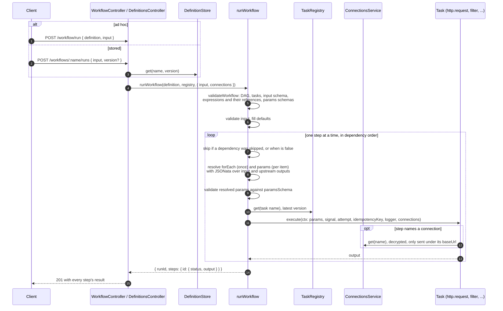
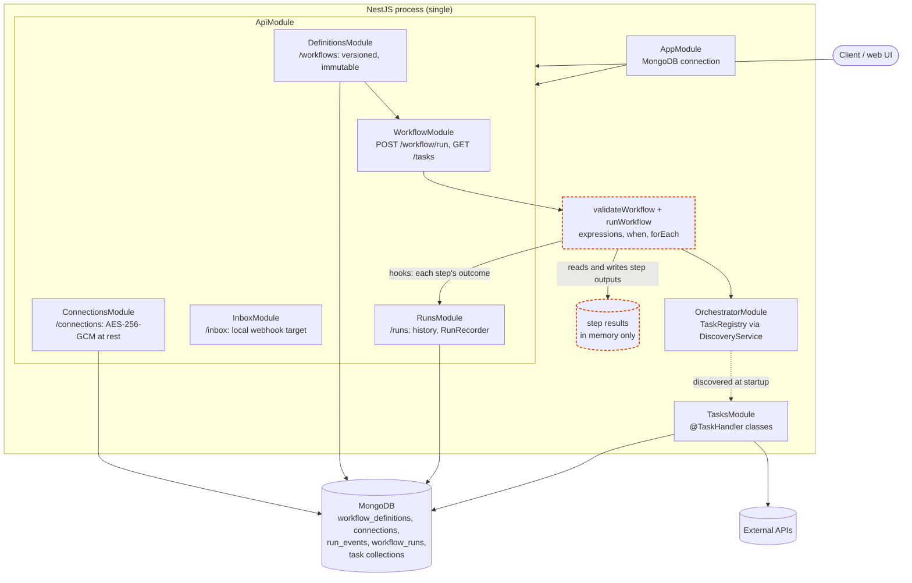
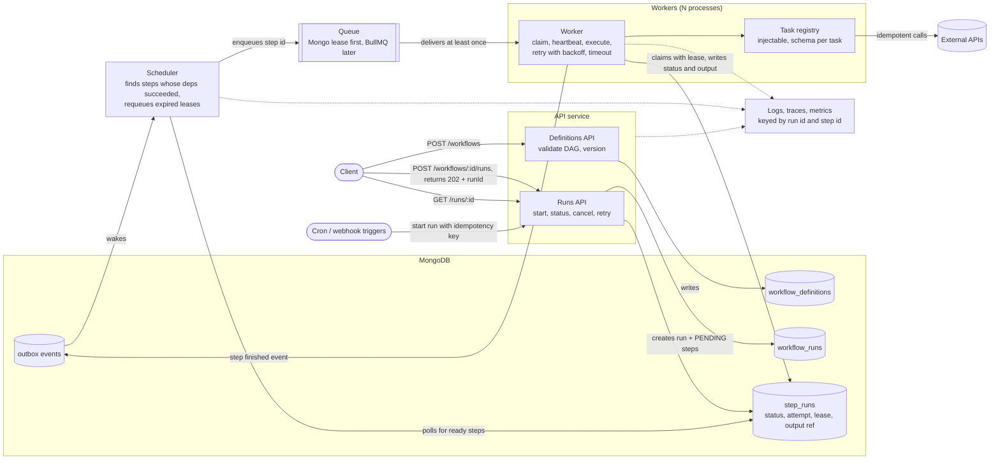
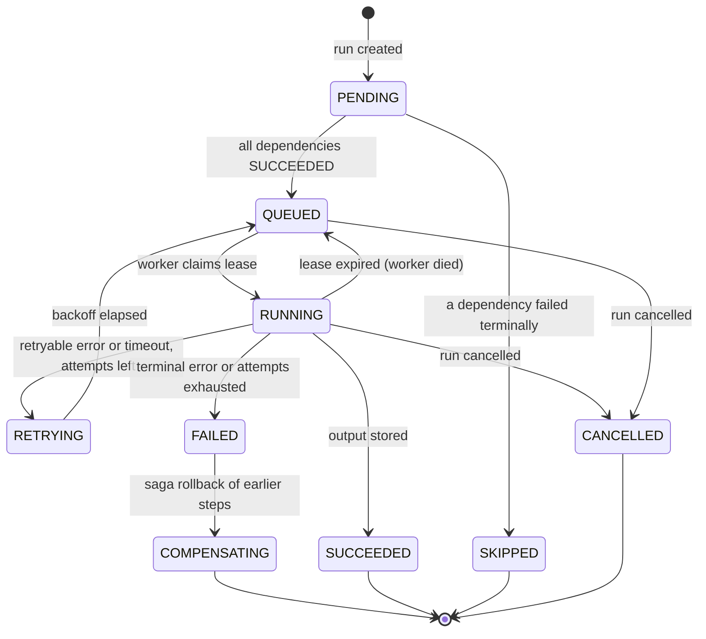

# OrchaLite architecture

> Sections 1 and 2 describe the system before phase B. Phase B built the target in
> sections 3 and 4; [engine-design.md](engine-design.md) describes it as built.

Four diagrams: what the code does today (1, 2), and where the roadmap takes it (3, 4).

## 1. Today: one request runs the whole workflow

As of the end of phase A (generality), plus run history. A definition is
validated and compiled up front, then run inside the HTTP request. Each step
is reported to a recorder that appends it to the run's history (see
[run-history-design.md](run-history-design.md)), but the run itself lives in
one process: a crash or client timeout ends it, and it is marked `ABANDONED`
on the next start rather than resumed.

## 2. Today: modules and where the weak points are

Dashed orange marks the weak points, which phase B addresses:

| Where | Problem |
| --- | --- |
| step results | Execution state lives in memory. History is recorded as the run goes, so a run can be inspected afterwards, but a crash or client timeout ends it and it cannot be resumed (B1, B2). |
| `runWorkflow` | Runs inside the request, one step and one `forEach` item at a time (B2, B4). No retries or timeouts: the abort signal is never fired and `attempt` is always 1 (B3). The first failure discards the outputs of steps that already succeeded (B1). |
| `delay` | Holds the request open, so it is capped at 60 seconds (B2). |

## 3. Target: durable engine with API, scheduler and workers split

The API only records intent. The scheduler decides what is ready. Workers do the
work and can die at any point without losing the run.

## 4. Target: lifecycle of one step

This state machine is the core of the engine. Every transition is a conditional
update on the `step_runs` document, so two workers can never both win.

## How the roadmap maps onto diagram 3

| Stage | Piece of the diagram it builds |
| --- | --- |
| A1-A4 (done) | Task registry with a schema per task, Definitions API with versions |
| B1. Persisted run as a state machine | Runs API, `workflow_runs`, `step_runs`, diagram 4 |
| B2. API, scheduler and workers split | Scheduler, Queue, Workers, leases |
| B3. Failure semantics | Retry, timeout and idempotency inside the worker |
| B4. Parallelism and backpressure | N workers, concurrency limits on the queue |
| B5. Sagas and triggers | Cron and webhook triggers, outbox, `COMPENSATING` |
| B6. Operability | Logs, traces, metrics |
