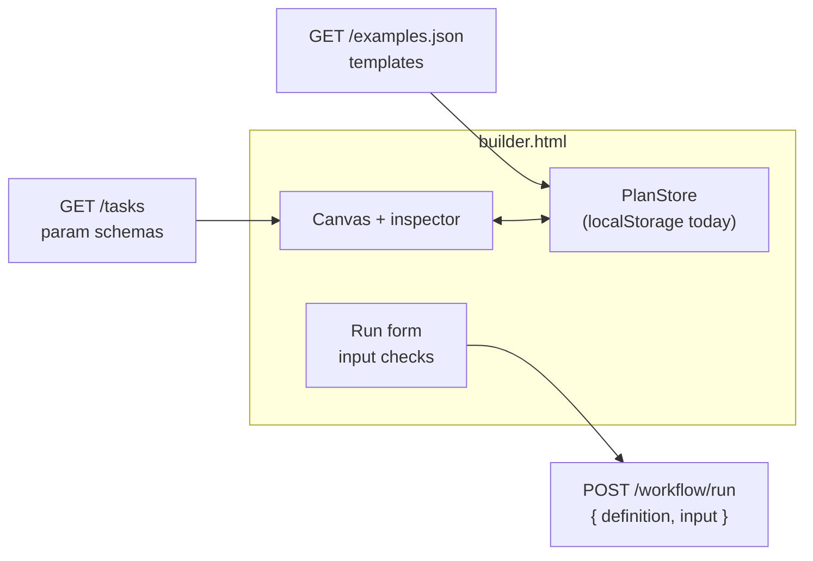

# Workflow builder

`public/builder.html`, served at http://localhost:3000/builder.html. One page,
no build step, like the classic editor at `/`.

A **workflow is a plan**: you create, edit, upload or download it, and draw it
on a canvas. A **run is a plan plus input values**, which are checked before
any step starts.

## What it does

| Area | Features |
| --- | --- |
| Plans | New, save (Ctrl/Cmd+S, with a version counter), duplicate, delete, switch between plans, warning before losing unsaved changes |
| Import and export | Upload one or more `.json` files (button, or drop them on the page); download the current plan as the bare definition the server accepts |
| Templates | Start a plan from any workflow in `public/examples.json`, with its sample input |
| Canvas | Drag a task from the list (or double-click it) to add a step; drag a node to move it; drag from a node's right dot to another node to add a dependency; click a connection and press Delete to remove it; auto-layout |
| Inspector | Step id (renaming updates `dependsOn` and `{{ steps.<id> }}` references), task, a form for each param built from the task's JSON Schema in `GET /tasks`, clickable `{{ input.x }}` / `{{ steps.<id>.output }}` references that insert into the last field you clicked |
| Plan settings | Name, description, run input declarations (type, default, pattern, max length, minimum, maximum) |
| JSON tab | The definition as JSON; edits apply to the canvas as soon as they parse |
| Quick checks | Duplicate or unusable ids, cycles, unknown tasks, missing required params, undeclared inputs, references to steps that are not upstream. Problem steps get a dashed red outline |
| Run | A form built from the input declarations; values are checked in the page (required, type, pattern, range) and nothing is sent until they pass. The server then checks the definition and input again. Results and errors are shown per step, and nodes turn green or red |

## How it fits together



The page uses three existing endpoints and adds none.

## Storage

Plans are kept in the browser's `localStorage` (`orchalite.plans.v1`), behind
a small `PlanStore` object with `list`, `get`, `save` and `remove`. When the
server gets a `/workflows` API (stage A4), only that object changes. A stored
plan is:

```json
{
  "id": "uuid",
  "definition": { "name": "...", "input": {}, "steps": [] },
  "layout": { "<step id>": { "x": 40, "y": 40 } },
  "description": "...",
  "version": 3,
  "updatedAt": "2026-10-25T05:00:00.000Z",
  "lastInput": { "org": "nestjs" }
}
```

Only `definition` is sent to the server or downloaded; the rest is editor state.

## Limits

- Plans live in one browser. Clearing site data deletes them, and they are not
  shared between machines until the server stores them.
- Quick checks are a subset of the server's. The server is the final word,
  for example on JSONata syntax and on params once expressions are resolved.
- No undo, zoom or multi-select yet.
