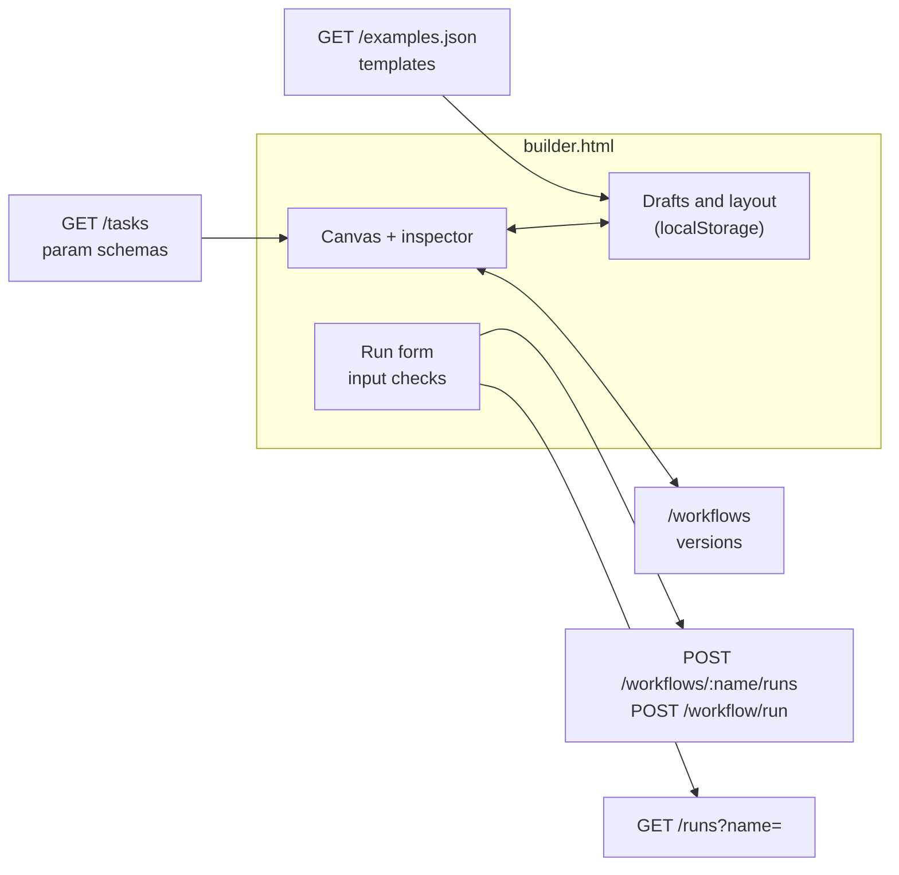

# Workflow builder

`public/builder.html`, served at http://localhost:3000/builder.html. One page,
no build step, like the classic editor at `/`.

A **workflow is a plan**: you create, edit, upload or download it, draw it on
a canvas, and save it as versions on the server. A **run is a plan plus input
values**, which are checked before any step starts.

## What it does

| Area | Features |
| --- | --- |
| Plans | Stored workflows from `GET /workflows`, plus drafts kept in this browser. Save (Ctrl/Cmd+S) stores the plan as the next version (`POST /workflows`); open any older version; duplicate as a draft; discard a draft. Warns before losing unsaved changes |
| Import and export | Upload one or more `.json` files (button, or drop them on the page): each is stored on the server, and any the server rejects opens as a draft with its reasons. Download the current plan as the bare definition |
| Templates | Start a draft from any workflow in `public/examples.json`, with its sample input |
| Canvas | Drag a task from the list (or double-click it) to add a step; drag a node to move it; drag from a node's right dot to another node to add a dependency (loops are refused); click a connection and press Delete to remove it; auto-layout. Nodes show `when` and `each` markers, and after a run turn green, red or dashed for skipped |
| Inspector | Step id (renaming updates `dependsOn` and `{{ steps.<id> }}` references), task, `when` and `forEach`, and a form for each param built from the task's JSON Schema in `GET /tasks`. Clickable `{{ input.x }}`, `{{ steps.<id>.output }}`, `{{ item }}` and `{{ index }}` references insert into the last field you clicked |
| Plan settings | Name, description, run input declarations (type, default, pattern, max length, minimum, maximum), versions |
| JSON tab | The definition as JSON; edits apply to the canvas as soon as they parse |
| Checks | In the page: duplicate or unusable ids, cycles, unknown tasks, missing required params, undeclared inputs, references to steps that are not upstream. On save, the server's full checks; its reasons are listed below the canvas until the next edit |
| Run | A form built from the input declarations; values are checked in the page (required, type, pattern, range) and nothing is sent until they pass. A stored, unchanged plan runs as its version (`POST /workflows/:name/runs`), so run history records which version ran; anything else runs as a draft (`POST /workflow/run`). Results per step, and the plan's recent runs with links into the run history |

## How it fits together

The page adds no endpoints of its own.

## Storage

- **The server holds the plans.** A saved plan is a stored workflow: its name
  is its identity and every save is a new immutable version. Saving under a new
  name starts a new workflow. Stored workflows cannot be deleted yet.
- **The browser holds drafts and editor state** in `localStorage`:
  - `orchalite.builder.drafts.v1`: plans not yet accepted by the server
    (new plans, templates, rejected uploads), saved as you edit
  - `orchalite.builder.meta.v1`: per workflow name, node positions, a
    description and the last run input. Moving nodes never creates a version.

Only the definition is sent to the server or downloaded.

## Limits

- Drafts and layout live in one browser.
- Checks in the page are a subset of the server's; the server is the final
  word, for example on JSONata syntax and on params once expressions resolve.
- No undo, zoom or multi-select yet.
