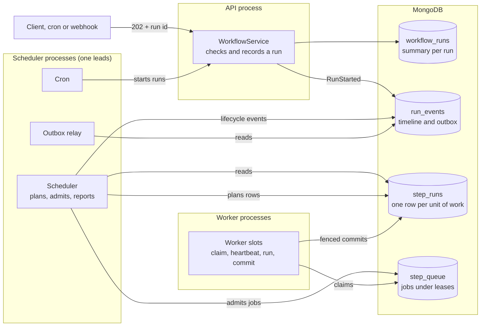
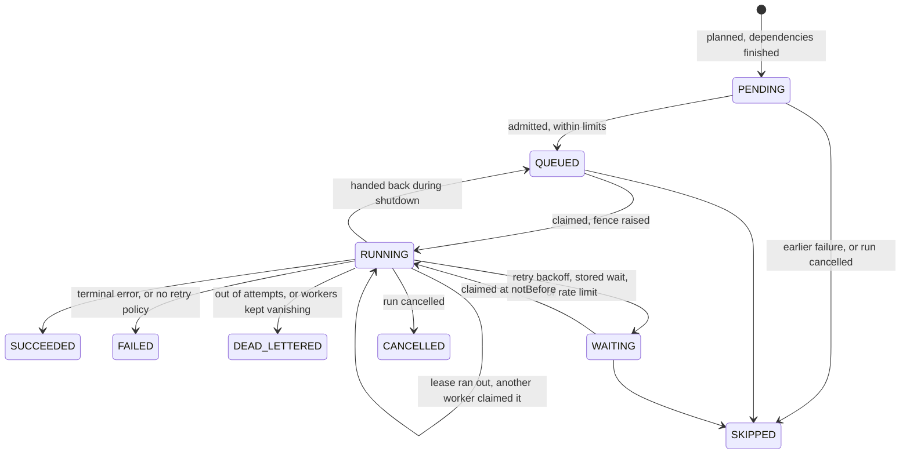
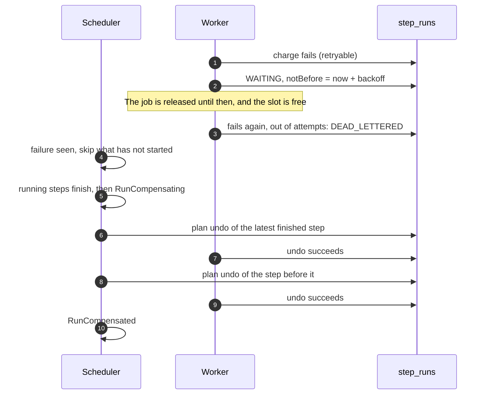

# Engine design

Status: implemented · 2026-10-31

How a run gets from a request to its end, and what happens when things break
along the way. This covers roadmap stages B1 to B6. The decisions and the reasons
for them are in the decision log in [objective.md](objective.md).

## The parts

Any process can do all three jobs, and any can be killed at any time. No process
holds state that matters: everything needed to carry on is in the database.

The rule that keeps this simple is **workers write only rows, and the scheduler
writes the story**. A worker reports by updating its row. The scheduler compares
rows with the timeline and appends whatever is missing, so it is the one author
of a run's lifecycle.

## Life of a step

Every change is a conditional update, so racing writers cannot corrupt a row.

## What each part does

**The scheduler** runs passes over active runs, on a timer and when nudged. Each
pass is level-triggered: it reads the current state and closes the gap.

1. Adds up any `forEach` step whose items have all finished.
2. Plans rows for steps whose dependencies have finished, evaluating `when` and
   `forEach`.
3. After a failure, skips everything that has not started.
4. Appends events for what the rows have done since the timeline last looked.
5. Admits pending work to the queue, within limits.
6. Ends the run once everything has finished.

Because each pass starts from state rather than from a message, a crash or a
missed nudge costs only time.

**A worker slot** loops: claim a job, take the row (raising its fence), renew the
lease while the task runs, then commit under that fence and acknowledge.

**The queue** only hands out row ids under a visibility timeout. Claiming moves a
job's `visibleAt` forward by the lease, so a job whose worker dies just becomes
visible again. Nothing needs to reap it.

## What happens when things break

| What breaks | What happens |
| --- | --- |
| Worker dies mid-step | Its renewals stop, the lease runs out, and another worker takes the job. The step runs again, under the same idempotency key |
| Worker stalls and wakes up after being replaced | Its commit fails the fence check, so its result is dropped. It also aborts its task once it sees the lease is gone |
| Worker dies after commit, before acknowledging | The job comes back, finds the row finished, and is acknowledged |
| A step keeps killing its worker | After 5 lost deliveries it is dead-lettered instead of looping |
| Scheduler dies | Another takes the lease and carries on from state |
| Two schedulers lead for a moment | Harmless: row inserts are idempotent, events claim a unique seq, and cron runs have idempotency keys. Limits may overshoot briefly |
| Process dies between writing an event and its summary | The next append catches the summary up from the events |
| Process dies between queueing a job and marking the row | The next pass queues it again, which changes nothing |
| Client repeats a request | An `Idempotency-Key` returns the first run |
| Worker is deployed | It drains: no new work, a grace period for what is running, then hands the rest straight back |

What this does not give is exactly-once execution, because nothing can. A step can
run twice. The engine's part is a key that never changes across retries and
redeliveries; a side effect is exactly-once only if its receiver uses that key.
`http.request` and `notify.webhook` send it, `mongo.insert` derives ids from it,
and `mongo.upsert` is naturally repeatable.

## Failure and rollback

A step is only undone after everything built on it. If an undo gives up, the way
back stops and the run ends `COMPENSATION_FAILED`, for a person to look at.

## Fairness and backpressure

Limits are enforced at admission, the move from `PENDING` to `QUEUED`:

- `concurrency` on a `forEach` step, and on a workflow across its runs
- `ORCHALITE_TASK_LIMITS` across all runs
- `ORCHALITE_RUN_WINDOW` for each run

What does not fit stays `PENDING`, so the queue stays short however large a
fan-out is, and a new run is never far from the front. Admission goes over all
runs, one row each in turn, starting from a different run each pass, so freed
slots are shared rather than kept by whichever run just finished something.

Connection rate limits apply when a task looks up its connection. A limited step
gives up its slot and returns once a call is allowed, using no attempt.

## Seeing what happened

| Signal | Where | Use it for |
| --- | --- | --- |
| Timeline | `GET /runs/:id/events` | The full story of one run |
| Traces | `ORCHALITE_TRACES` | One trace per run, one span per attempt, across processes. The trace id is derived from the run id, so nothing is passed between processes |
| Logs | JSON lines on stdout | Filter by `runId`, `stepId` or `traceId` |
| Metrics | `GET /metrics` | `orchalite_queue_depth`, `orchalite_step_duration_seconds`, `orchalite_step_attempts_total`, `orchalite_runs_ended_total`, `orchalite_runs_active` |

Params and outputs are kept out of logs and traces, because they can hold secrets.

## Testing

Failure claims are tested by causing the failure (principle 3):

| Claim | Test |
| --- | --- |
| A killed worker's step finishes elsewhere | `engine/worker-crash.e2e.spec.ts`: `SIGKILL` to a compiled worker process mid-step |
| A stored wait survives a worker restart | `engine/worker-crash.e2e.spec.ts` |
| A stale worker cannot overwrite a newer one | `engine/engine.spec.ts`, "fencing" |
| A step that fails twice has its effect once | `engine/failure-semantics.e2e.spec.ts`: a server that fails after doing the work |
| A 1,000-item fan-out respects its limit and starves nobody | `engine/fan-out.e2e.spec.ts` |
| A webhook automation rolls back | `triggers/triggers.e2e.spec.ts` |
| Cron survives losing its leader | `engine/leader.e2e.spec.ts`: `SIGKILL` to the leading scheduler process |
| A run can be diagnosed from telemetry | `telemetry/operability.e2e.spec.ts` |
| Shutdown drains, and hands back what outlasts it | `telemetry/operability.e2e.spec.ts`: `SIGTERM` to a worker process |
| All queue adapters behave the same | `engine/step-queue.spec.ts` |
