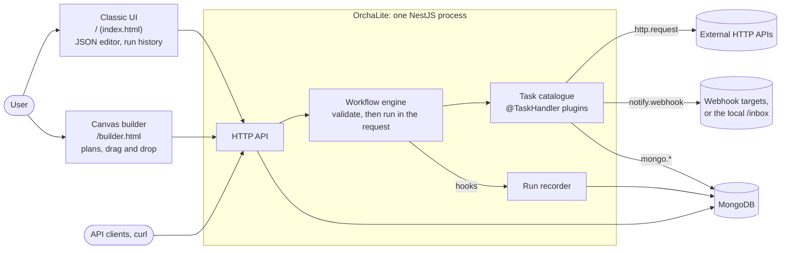
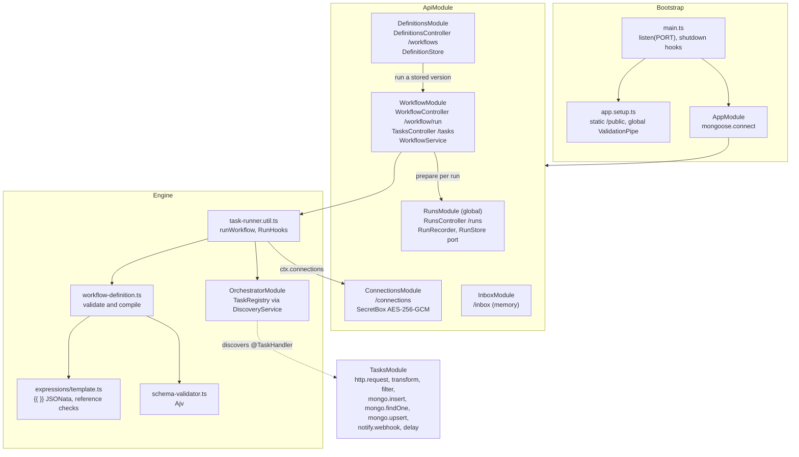
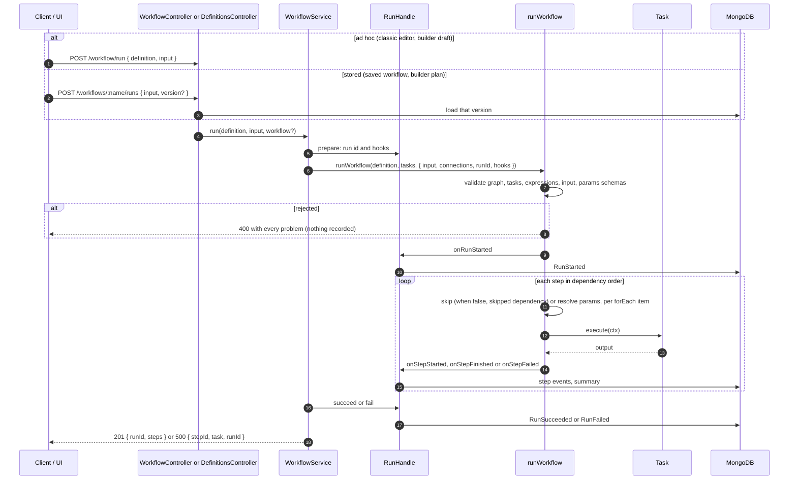
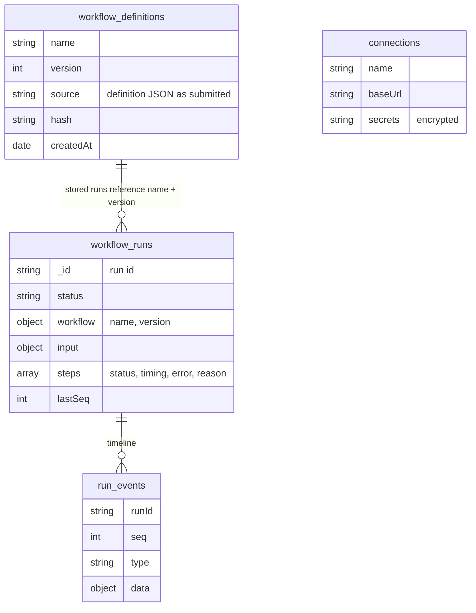

# OrchaLite high-level design (current state)

What the code on `main` does as of 2026-10-25: phase A (generality) done, run
history recorded, and a canvas builder. For where it is heading, see
[objective.md](objective.md) and the target diagrams in
[architecture.md](architecture.md).

## 1. System context

## 2. Modules

## 3. Running a workflow

## 4. Data

| Collection | Owner | Holds |
| --- | --- | --- |
| `workflow_definitions` | DefinitionStore | Immutable versions per name; unique `(name, version)` |
| `connections` | ConnectionsService | Base URL and secrets encrypted with `ORCHALITE_SECRET_KEY` |
| `run_events` | MongoRunStore | Append-only run timeline; unique `(runId, seq)` |
| `workflow_runs` | MongoRunStore | One summary per run, rebuilt from its events |
| any (task-chosen) | `mongo.insert`, `mongo.upsert` | Workflow data, such as stored repos or a release watcher's last version |

In the browser (builder only): drafts and per-workflow layout in
`localStorage`.

## 5. Front ends

| Page | For | Talks to |
| --- | --- | --- |
| `/` classic UI | JSON editing with live graph, stored workflows, connections, inbox, **run history** with step timeline, `/#run=<id>` links | `/tasks`, `/workflow/run`, `/workflows`, `/connections`, `/inbox`, `/runs` |
| `/builder.html` | **Plans**: canvas, schema-driven param forms, run inputs and a checked run form, versions, drafts, upload and download | `/tasks`, `/examples.json`, `/workflows`, `/workflow/run`, `/runs` |

Both are single static files with no build step. See [builder.md](builder.md).

## 6. Known limits

Sections 2 to 4 above were written before phase B. For how runs execute now, with
the scheduler, workers and queue, see [engine-design.md](engine-design.md).

| Area | Limit | Roadmap |
| --- | --- | --- |
| Queue | MongoDB only; the BullMQ adapter is not built | B2 |
| Triggers | API only, with no UI | Not planned yet |
| Scheduling cost | Each pass reads all of a run's rows, so very large fan-outs spend most of their time here | Not planned yet |
| Overlapping runs | A workflow's `concurrency` limits steps, not runs | Open |
| Stored workflows | Versions cannot be deleted | Not planned yet |
| Builder | Drafts and layout are per browser; no undo or zoom; retry, timeout and compensate are kept in a definition but cannot be edited on the canvas | Horizon 4 for the full editor |
