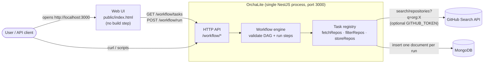
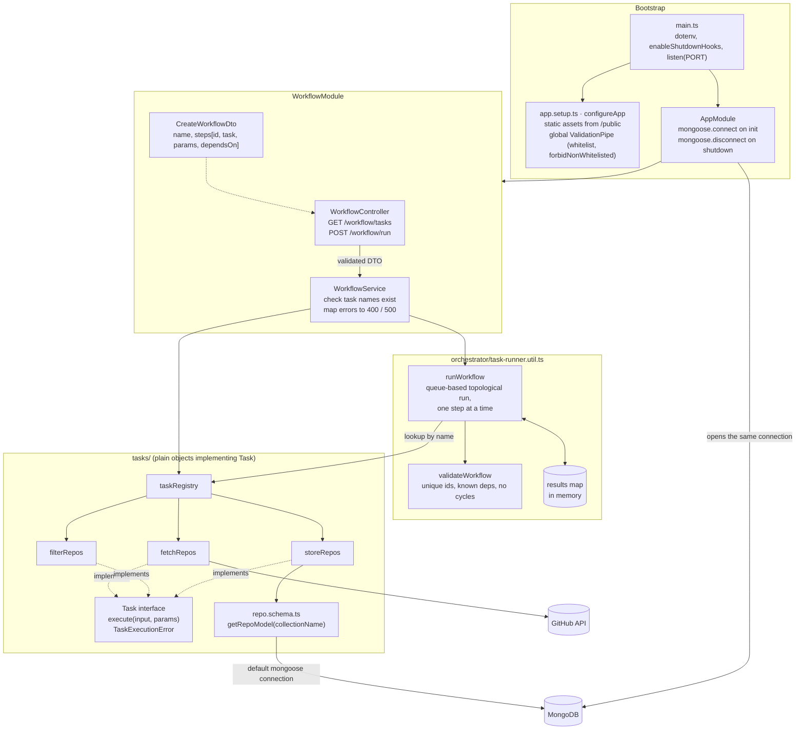
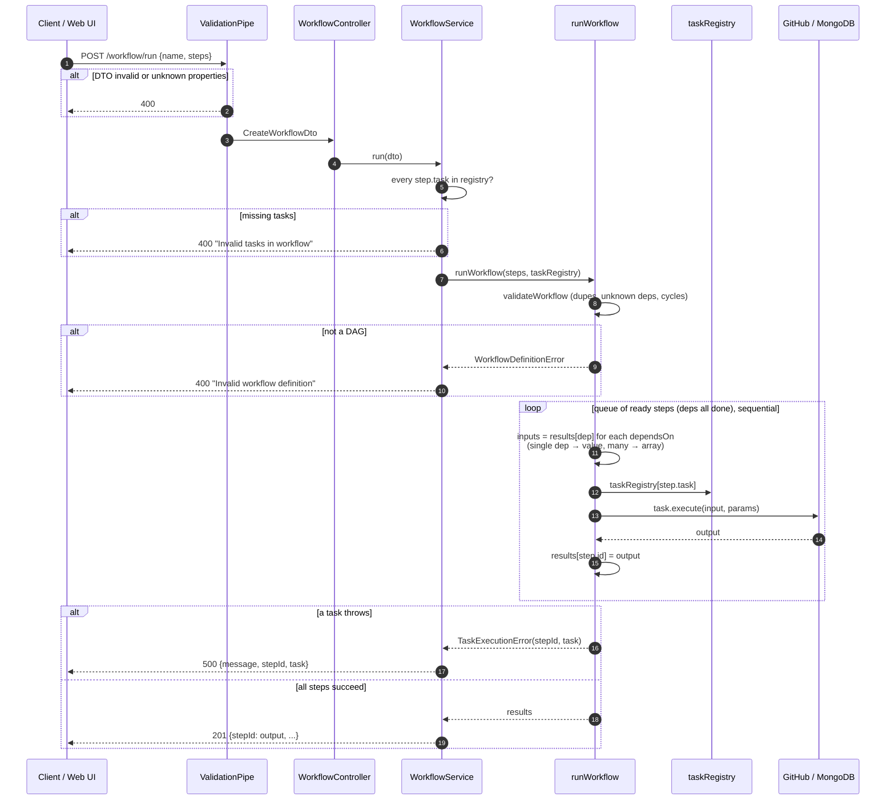
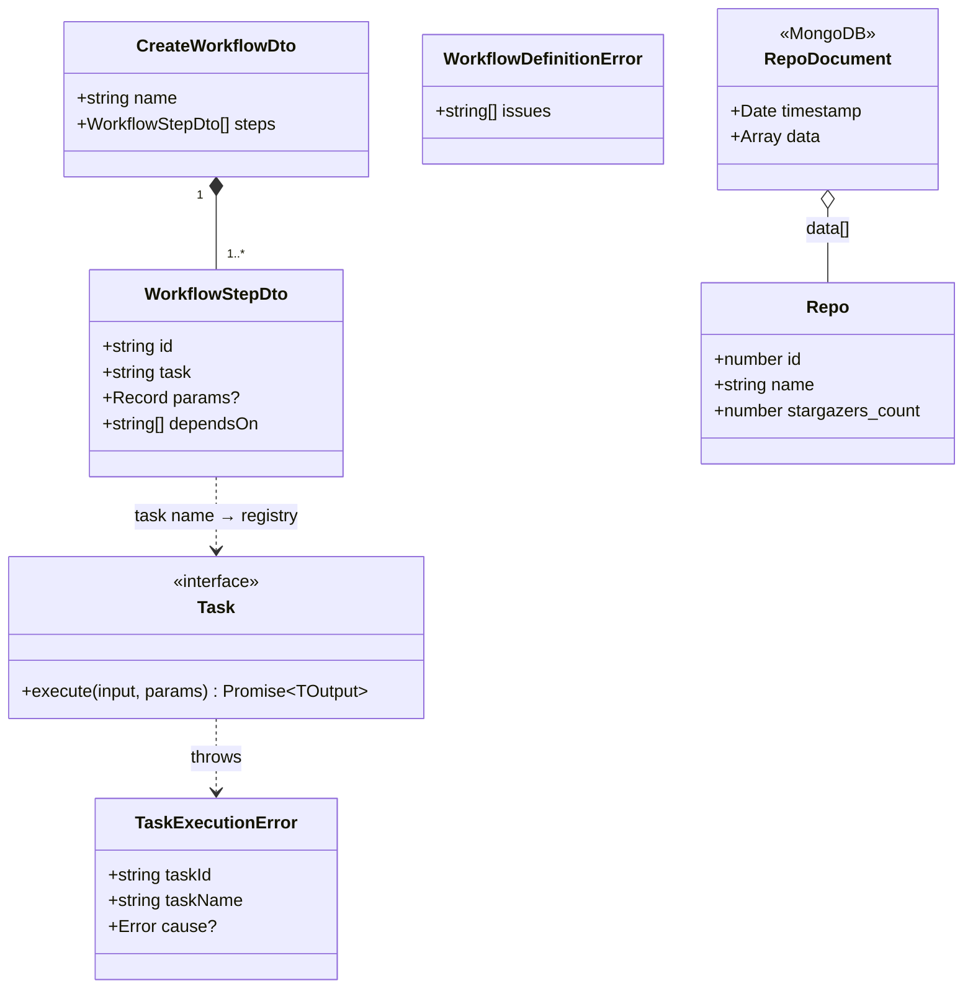
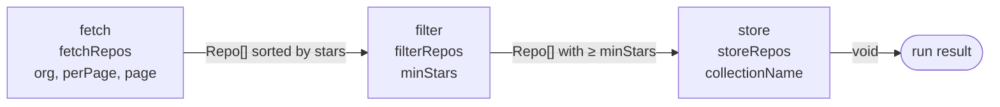

# OrchaLite high-level design (current state)

What the code on `main` does today. For the target design and roadmap, see
[architecture.md](architecture.md) (diagrams 3 and 4) and [objective.md](objective.md).

## 1. System context

## 2. Components

## 3. Request flow: `POST /workflow/run`

The whole run happens inside the HTTP request; the client waits for every step.

## 4. Data model

## 5. Built-in task pipeline (example workflow)

## Known limits today

| Area | Limit |
| --- | --- |
| Durability | Run state is the in-memory `results` map; a crash or client timeout loses the run. No run history. |
| Execution | Steps run sequentially even when independent; no parallelism. |
| Failure handling | No retries, no timeouts; first failure aborts the run. |
| Tasks | Plain objects outside Nest DI; registry is a static import. |
| Storage | `storeRepos` writes the whole array into one document (16MB cap). |
