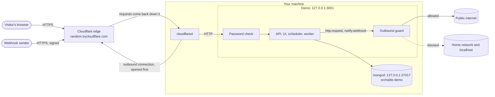
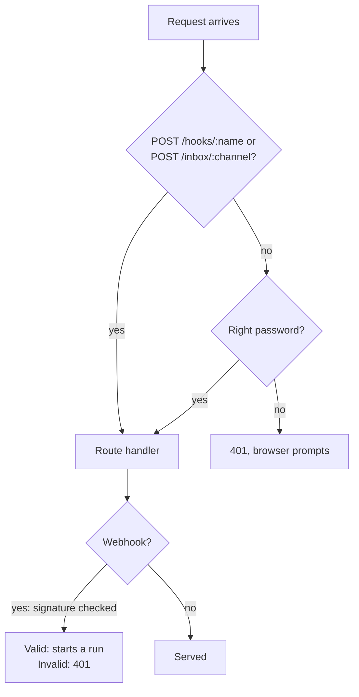
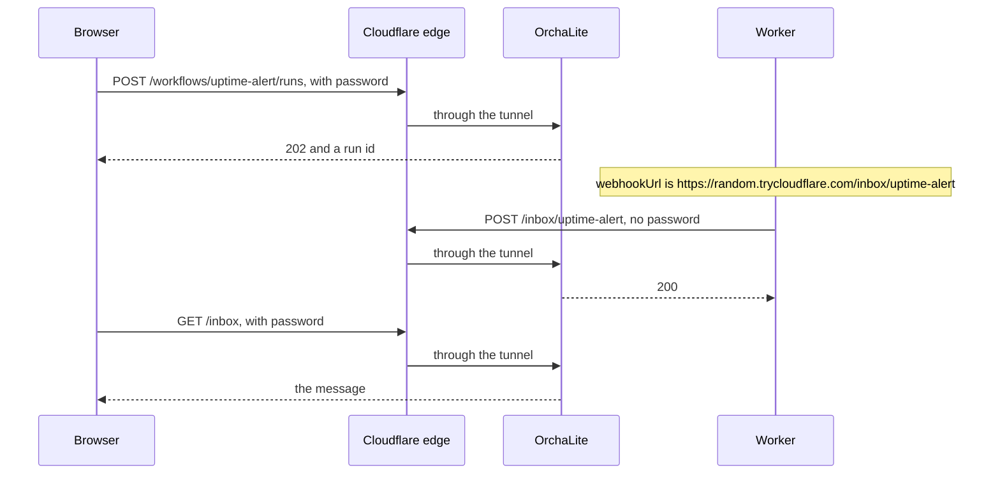
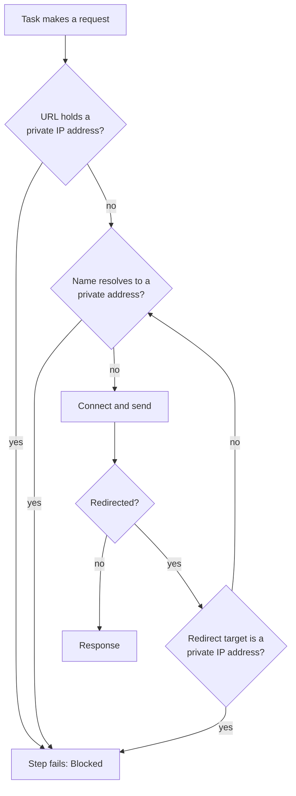
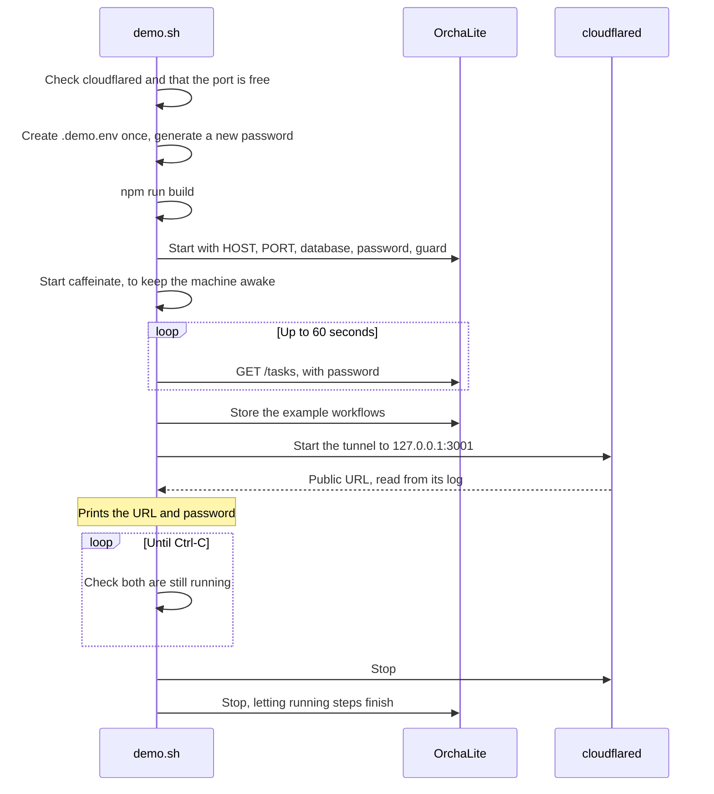

# How the remote demo works

`scripts/demo.sh` shows OrchaLite to other people from your own machine. There is
no hosting and no open port on your router, and your local development setup
keeps running beside it. For the commands alone, see "Remote demo" in the
[README](../README.md).

## 1. The path of a request

`cloudflared` opens a connection out to Cloudflare, and visitors' requests come
back down it. Nothing on the internet connects to your machine directly, which
is why the router needs no changes and your home IP stays hidden.

HTTPS ends at Cloudflare, so Cloudflare can see the traffic, including the
password. Use demo data only, and keep real credentials out of the demo's
connections.

## 2. What protects what

The demo gives people the ability to run workflows, so it is guarded in both
directions.

| Risk | Protection | Where |
| --- | --- | --- |
| A stranger finds the URL | Basic Auth over the API and the UI | `src/demo/basic-auth.ts` |
| Someone on your Wi-Fi skips the tunnel | The app listens on `127.0.0.1` only | `HOST` in `src/main.ts` |
| A workflow reaches your router or local services | Private addresses are refused | `src/tasks/outbound-guard.ts` |
| A demo visitor touches your dev data | A separate `orchalite-demo` database | `DEMO_MONGODB_URI` in `scripts/demo.sh` |
| A live demo changes while you code | Its own git worktree | See section 6 |

MongoDB already listens on `127.0.0.1` only, and the tunnel forwards one port,
so MongoDB stays private.

## 3. The password check

The check runs before everything else, so it covers the static UI as well as the
API. A browser asks for the password once and then sends it with every request
to the same site, so the UI needs no login code.

Two routes stay open, each for its own reason:

- **`POST /hooks/:name`** is called by outside services, which prove themselves
  with an HMAC signature over the raw body, valid for 5 minutes.
- **`POST /inbox/:channel`** is called by the engine itself. See the next section.
  It is low risk: it only keeps the latest 100 messages, in memory, and reading
  them still needs the password.

Any username is accepted; only the password counts. It is compared by digest so
that timing reveals nothing about it.

## 4. Why the inbox has to stay open

The UI fills in `webhookUrl` from the address the page was opened on. On the demo
that is the public URL, so a run notifying the inbox leaves your machine and comes
back through the tunnel, with no password to send.

This is also why you should open the demo through the public URL. Opened through
`localhost`, the UI would build a `localhost` inbox URL, and the guard would block
it.

## 5. The outbound guard

`ORCHALITE_BLOCK_PRIVATE_NETWORK` stops `http.request` and `notify.webhook`
reaching this machine or a private network. Checking the URL alone would not be
enough, so it checks at three points:

| Check | What it stops |
| --- | --- |
| URL, before the request | `http://192.168.1.1`, and spellings of it that a URL parser normalises, such as `http://2130706433` |
| Connection-time lookup, on the HTTP agent | `http://localhost`, and a name that resolves to a public address when first asked and a private one later (DNS rebinding) |
| Each redirect | A public URL that redirects to `169.254.169.254` |

Node skips the lookup for a bare IP address, which is why the first and third
checks exist. It covers IPv4 and IPv6 private ranges, including IPv4 written
inside IPv6, such as `::ffff:127.0.0.1`.

The guard covers those two tasks. `mongo.*` tasks stay inside the demo database,
and `ORCHALITE_EVENTS_WEBHOOK_URL` is set by you, not by a workflow.

## 6. Running beside local development

| | Local development | Demo |
| --- | --- | --- |
| Start with | `npm run start:dev` | `./scripts/demo.sh` |
| Port | 3000, all interfaces | 3001, `127.0.0.1` only |
| Database | `MONGODB_URI` | `orchalite-demo`, on the same `mongod` |
| Password and guard | Off | On |
| Code | Your working checkout | Its own worktree |

The settings the demo adds are all off unless set, so local development and the
tests behave as before. The worktree matters because `start:dev` rebuilds `dist/`
and `public/` is served straight from the checkout, so sharing one would put
unfinished work into a live demo.

## 7. What the script does

- `.demo.env` holds `ORCHALITE_SECRET_KEY`, which encrypts stored connections.
  It has to outlive each run or they could no longer be decrypted, so it is
  created once and is ignored by git.
- The password is new on every run, so a shared one stops working after the demo.
- If the app or the tunnel stops, the script stops the other, so the app is never
  left running without you noticing.

Seeding reports three examples as skipped: `undeclared-dependency`, `bad-params`
and `cycle-example` are invalid on purpose.

## 8. Limits

- **Availability:** the demo is up only while your machine is on, awake and online.
  `caffeinate` does not reliably keep a Mac awake with the lid closed.
- **Changing URL:** a quick tunnel gets a new URL each time it starts. A stable one
  needs a named tunnel, a Cloudflare account and your own domain.
- **Quick tunnel limits:** 200 in-flight requests, no Server-Sent Events and no
  uptime guarantee. The app uses no Server-Sent Events.
- **Long requests:** Cloudflare can cut off a response that takes too long, at about
  100 seconds. The UI polls so is not affected, but an API call with `?wait=true` on
  a long run could get a `524` while the run itself carries on.

## 9. Troubleshooting

| You see | Meaning | Do |
| --- | --- | --- |
| `cloudflared is not installed` | The tunnel is missing | `brew install cloudflared` |
| `port 3001 is in use` | Another demo or app is running | Stop it, or set `DEMO_PORT` |
| `the app stopped while starting` or `the app did not become ready` | The app could not start, often because MongoDB is not running; its log is above | Start `mongod`, then rerun |
| `the tunnel did not start` | `cloudflared` could not get a URL; its log is printed | Check your connection and rerun |
| A step fails with `Blocked: ...` | The guard refused a private address | Expected in the demo; use a public URL |
| An inbox notification fails | The page was opened through `localhost` | Open it through the public URL |
| `401` from `/hooks/:name` | The signature is wrong or over 5 minutes old | Re-sign with the trigger's secret |
