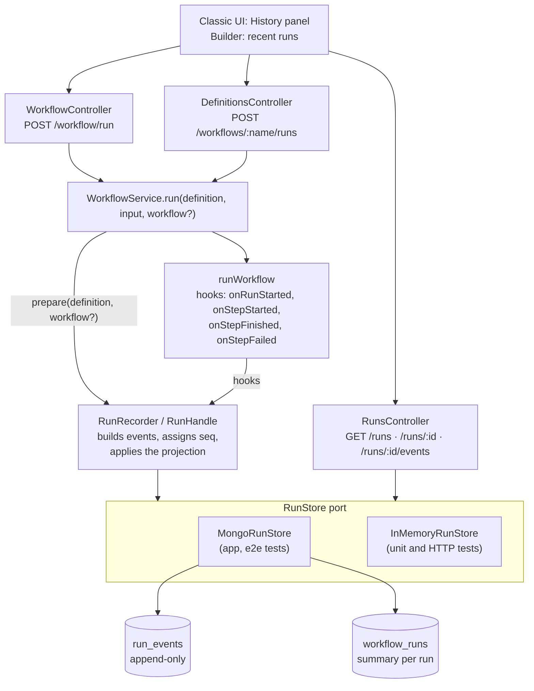
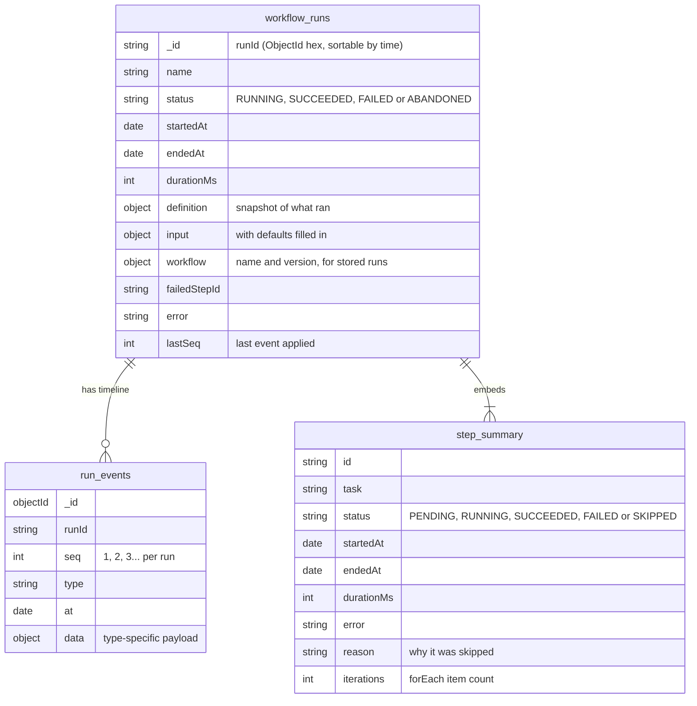
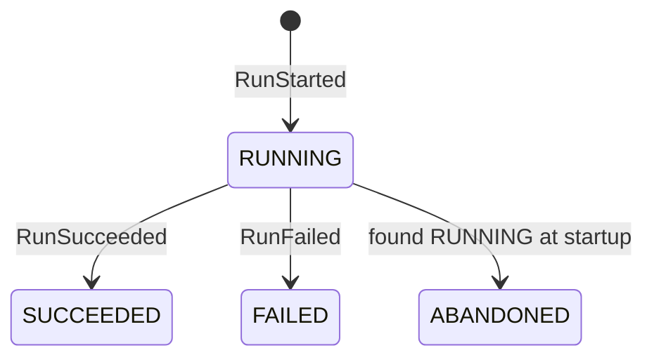
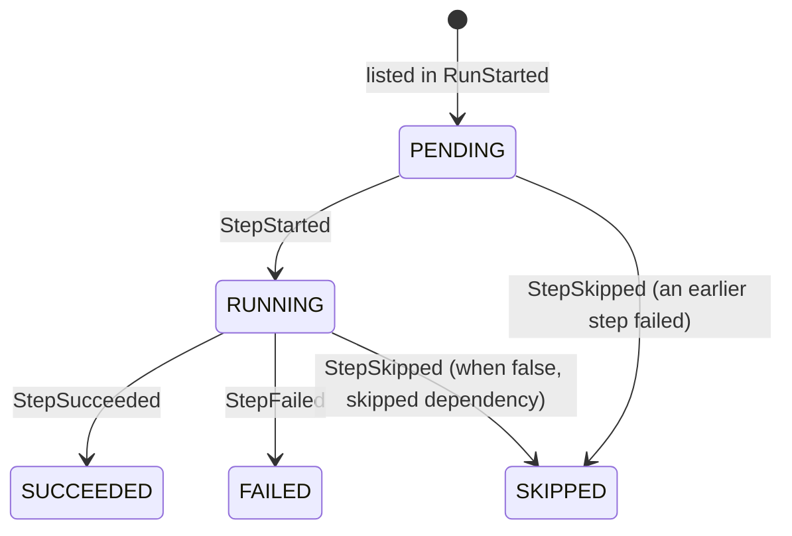
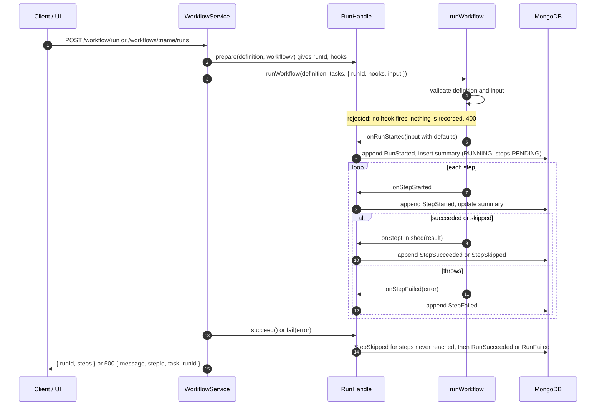

# Run history design

Status: implemented · 2026-10-25. Written for the first slice of B1, when runs
still executed in the request. The event model and API here stand; for how runs
execute now, and how events are written, see [engine-design.md](engine-design.md).

## Goal

Keep a record of every workflow run so you can answer:

- Which runs have I done, and did each one succeed?
- For one run: which steps ran, in what order, when each started and finished,
  how long it took, what it returned or why it failed or was skipped, what input
  it got, and which stored version of the workflow ran.

This is a first slice of roadmap stage **B1 (persisted run as a state
machine)**. It records runs as they happen but does not change how they
execute: a run still happens inside the HTTP request.

## Non-goals (for this slice)

- Async runs (`202` + poll). Stays in B1 proper.
- Resuming a crashed run, retries, leases. That is B2 and B3.

## Key decision: events as the source of truth, plus a summary

| | Mutable status document only | Append-only events + summary (chosen) |
| --- | --- | --- |
| What is stored | One doc per run, updated in place | Immutable events per run; a summary doc rebuilt from them |
| "When did step X start?" | Only if we remembered to add a field | Always, it is an event |
| Debugging a weird run | Final state only | Full timeline |
| Listing runs | Easy | Easy, from the summary |
| Horizon 2 (Kafka, Cassandra) | Redesign | Port: events map directly onto a topic or a partition |
| Cost | Simplest | Two writes per transition; the summary can lag |

What it teaches: event sourcing, projections (read models), and what happens
when the two writes are not atomic.

## Components

The runner stays free of persistence. It reports what happens through hooks,
and a recorder decides where that goes, through a store port (ports and
adapters).

| File | Role |
| --- | --- |
| `orchestrator/task-runner.util.ts` | `RunOptions.hooks`. `onRunStarted(input)` fires only after the definition and input pass their checks, with defaults filled in. `onStepFinished` covers succeeded and skipped steps. |
| `runs/run-projection.ts` | `applyEvent` and `replay`: the pure function from events to a summary |
| `runs/run-recorder.ts` | `RunRecorder.prepare()` returns a `RunHandle` whose hooks append events and update the summary; it writes nothing until `onRunStarted`. Closes abandoned runs at startup. |
| `runs/run-store.ts` | `RunStore` port: `appendEvent`, `saveSummary`, `listRuns`, `getRun`, `getEvents`, `findRunning` |
| `runs/mongo-run-store.ts`, `runs/in-memory-run-store.ts` | Adapters |
| `runs/runs.module.ts` | `RunsModule.forRoot(store)`, global; MongoDB by default (`ApiModule`), in-memory in the HTTP spec |
| `workflows/workflow.service.ts` | Prepares a handle per run, passes its id and hooks to the runner, records success or failure, and adds `runId` to a failed step's `500` |

## Data model

| Event `type` | `data` |
| --- | --- |
| `RunStarted` | `{ definition, input, workflow? }` |
| `StepStarted` | `{ stepId, task }` |
| `StepSucceeded` | `{ stepId, output, iterations? }` (outputs over 256 KB become `{ truncated, sizeBytes, preview }`) |
| `StepFailed` | `{ stepId, error }` |
| `StepSkipped` | `{ stepId, reason }`: `when was false`, `dependency "x" was skipped`, or `an earlier step failed` |
| `RunSucceeded` / `RunFailed` | `{ failedStepId?, error? }` |
| `RunAbandoned` | `{ error: "The server stopped while this run was in progress" }` |

Durations are not stored in events; the projection computes them from the
event timestamps.

Indexes:

- `run_events`: unique `{ runId: 1, seq: 1 }`. Orders the timeline and makes a
  duplicate append fail instead of silently doubling an event.
- `workflow_runs`: `{ status: 1, _id: -1 }` and `{ name: 1, _id: -1 }` for the
  filtered lists. Run ids are ObjectId hex strings, which sort by creation
  time, so sorting by `_id` is sorting by start time.
- No TTL: all history is kept.

## States

Run status:

Step status:

## Recording a run

Notes:

- **Recording never breaks a run.** If MongoDB is down, writes are logged and
  the workflow still runs. History then has a gap, which is visible because
  `lastSeq` stops increasing.
- **One run id everywhere.** The recorder picks the id and hands it to the
  runner, so the `runId` in a response, the idempotency keys tasks receive and
  `/runs/:id` all match.

## The two-write problem

Each transition writes an event and then updates the summary. A standalone
MongoDB server has no multi-document transactions (those need a replica set).
If the process dies between the two writes, the summary is one event behind.

Handling it:

1. Events are the truth. The summary stores `lastSeq`, and replaying the events
   rebuilds it. That is what a projection is.
2. On startup, any run still `RUNNING` is from a dead process (runs only live
   inside a request). The app rebuilds its summary from the events and appends
   `RunAbandoned`. Steps keep their last recorded status, so a step left
   `RUNNING` shows where the process died.

This is the same gap B2 closes properly with leases and heartbeats; here it is
only detected, not recovered.

## API

| Method | Path | Returns |
| --- | --- | --- |
| `GET` | `/runs?status=FAILED&name=popular-repos&limit=20&before=<runId>` | Summaries without the definition snapshot, newest first, cursor-paginated by run id |
| `GET` | `/runs/:id` | Summary with input, workflow version and per-step status and timings |
| `GET` | `/runs/:id/events` | The full timeline, including step outputs |

Cursor pagination on the run id (`before=`) instead of `skip` keeps pages
stable while new runs arrive.

## UI

- **Classic UI** (`/`): a Run history panel (status, name, start time with
  time zone, duration, stored version, failed step), filter by status, load
  older runs. Opening a run shows a timeline bar per step, its input, outputs,
  errors and skip reasons, and **Load into editor**. `/#run=<id>` opens one
  directly.
- **Builder** (`/builder.html`): the run panel lists the plan's recent runs
  and links each to the classic UI.

## Testing

- Runner: hooks fire in order for started, succeeded, skipped and failed
  steps, and not at all for rejected input.
- Recorder with `InMemoryRunStore`: nothing recorded before the run starts;
  increasing `seq`; summary equals a replay of the events; skip reasons and
  `forEach` counts; store outages don't throw; abandoned runs; list filters
  and cursor; duplicate `seq` rejected; output cap.
- HTTP (in memory): run ids, `/runs/:id`, events, failed and skipped steps,
  rejected definitions and input not recorded, list filters, `400` and `404`.
- End to end with MongoDB: a stored-workflow run records its version and input.
- Browser (Playwright, outside the repo): builder runs, recent runs,
  `#run=` links, the history panel and Load into editor.

## Decisions

- Built ahead of B1 proper, agreed 2026-10-25.
- Output cap: 256 KB.
- Retention: keep all history.
