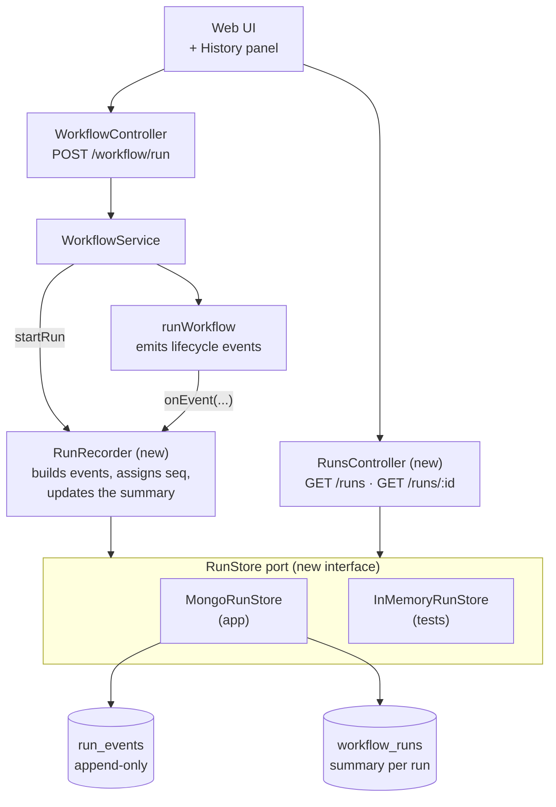
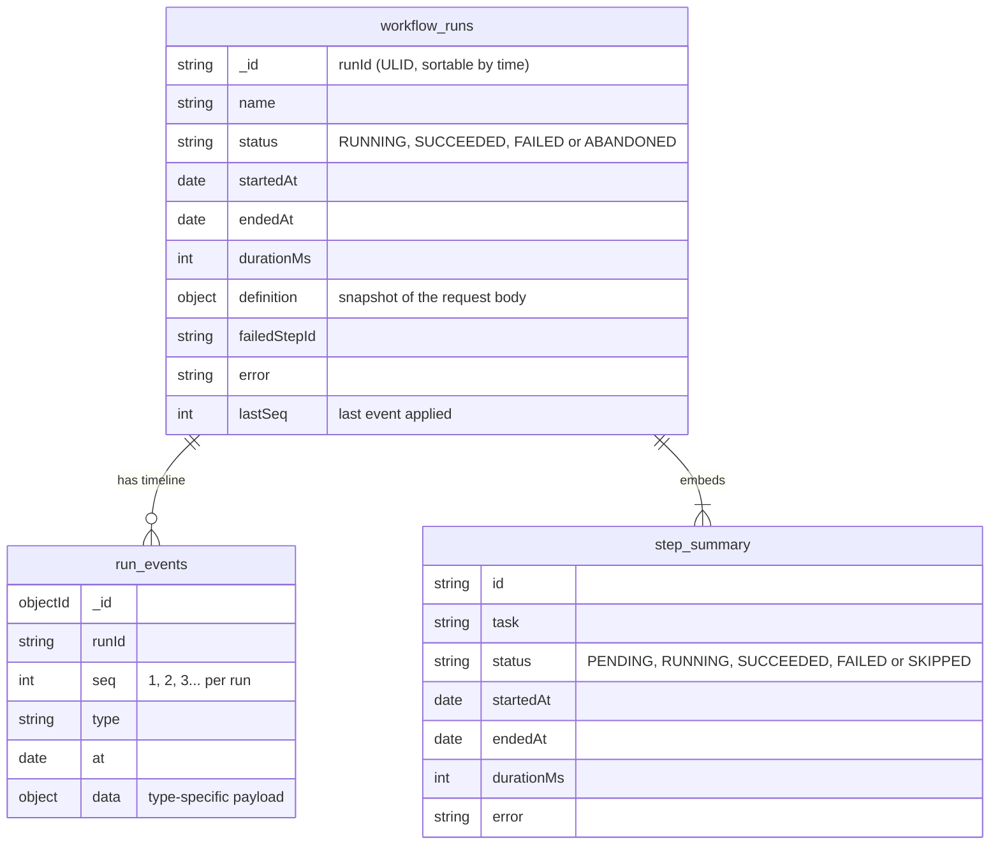
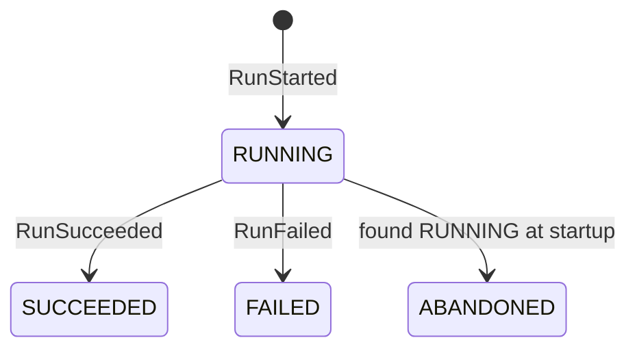
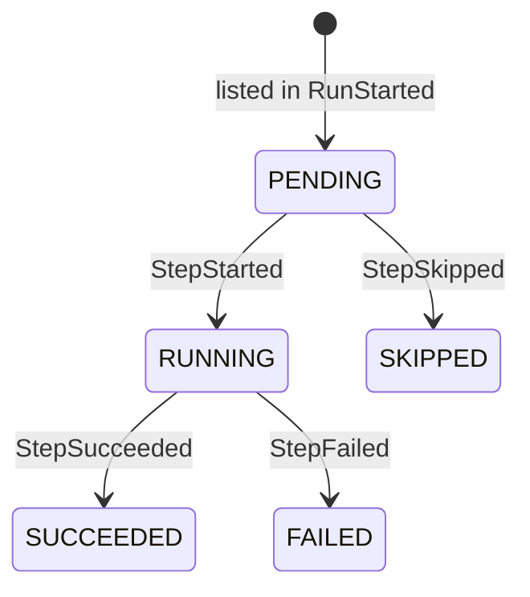
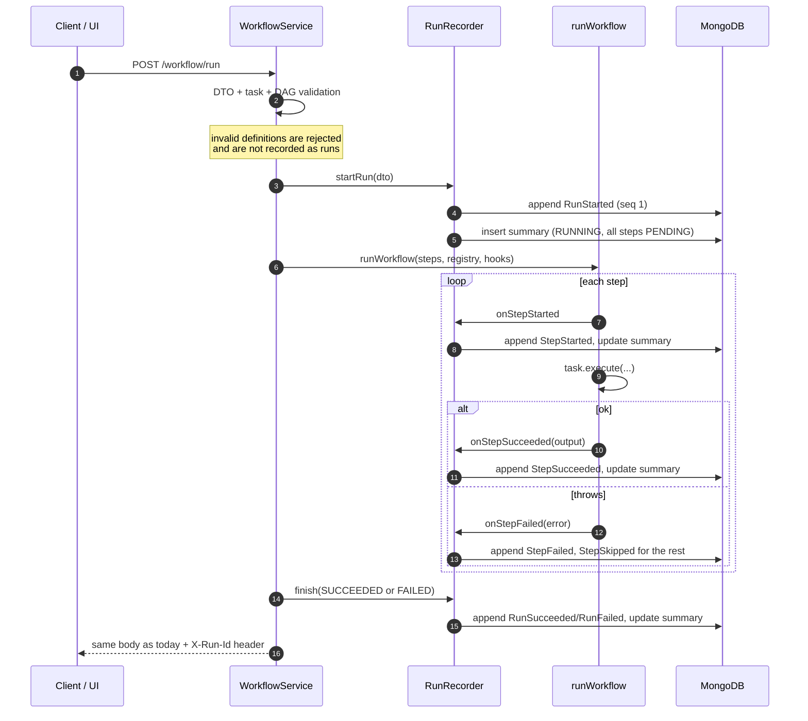

# Run history design

Status: proposal · 2026-10-25

## Goal

Keep a record of every workflow run so you can answer:

- Which runs have I done, and did each one succeed?
- For one run: which steps ran, in what order, when each started and finished,
  how long it took, and what it returned or why it failed.

This is a thin first slice of roadmap stage **B1 (persisted run as a state
machine)**. It records runs as they happen but does not change how they
execute: the run still happens inside the HTTP request, one step at a time.

## Non-goals (for this slice)

- Async runs (`202` + poll). Stays in B1 proper.
- Resuming a crashed run, retries, leases. That is B2 and B3.
- Stored, versioned definitions. That is A4, so each run keeps a snapshot of
  the definition it ran.

## Key decision: events as the source of truth, plus a summary

The roadmap's open decision "run history model" leans event-sourced. This
design follows that, with a read-friendly summary next to it.

| | Mutable status document only | Append-only events + summary (chosen) |
| --- | --- | --- |
| What is stored | One doc per run, updated in place | Immutable events per run; a summary doc rebuilt from them |
| "When did step X start?" | Only if we remembered to add a field | Always, it is an event |
| Debugging a weird run | Final state only | Full timeline |
| Listing runs | Easy | Easy, from the summary |
| Horizon 2 (Kafka, Cassandra) | Redesign | Port: events map directly onto a topic or a partition |
| Cost | Simplest | Two writes per transition; the summary can lag |

What it teaches: event sourcing, projections (read models), and what happens
when the two writes are not atomic.

## Components

The runner stays free of persistence. It reports what happens through a small
port, and an adapter decides where that goes (ports and adapters).

Changes by file:

| File | Change |
| --- | --- |
| `orchestrator/task-runner.util.ts` | Accepts an optional `hooks` argument: `onStepStarted`, `onStepSucceeded`, `onStepFailed`. No storage code. |
| `runs/run-store.ts` (new) | `RunStore` interface: `append(event)`, `upsertSummary(run)`, `listRuns(filter)`, `getRun(id)`, `getEvents(id)`. |
| `runs/mongo-run-store.ts` (new) | Mongoose models for the two collections. |
| `runs/in-memory-run-store.ts` (new) | Used by the HTTP specs, which run without MongoDB. |
| `runs/run-recorder.ts` (new) | Turns hooks into events and keeps the summary in step. |
| `runs/runs.controller.ts` (new) | Read API. |
| `workflows/workflow.service.ts` | Creates the run before executing, wires the recorder in, records the final outcome. |
| `public/index.html` | History panel and run detail view. |

## Data model

Event types:

| `type` | `data` |
| --- | --- |
| `RunStarted` | `{ name, definition }` |
| `StepStarted` | `{ stepId, task, params }` |
| `StepSucceeded` | `{ stepId, durationMs, output }` (see output size below) |
| `StepFailed` | `{ stepId, durationMs, error }` |
| `StepSkipped` | `{ stepId, reason: "upstream failed" }` |
| `RunSucceeded` / `RunFailed` | `{ durationMs, failedStepId?, error? }` |
| `RunAbandoned` | `{ reason: "process restarted while running" }` |

Indexes:

- `run_events`: unique `{ runId: 1, seq: 1 }`. Orders the timeline and makes a
  duplicate append fail instead of silently doubling an event.
- `workflow_runs`: `{ startedAt: -1 }`, `{ status: 1, startedAt: -1 }`,
  `{ name: 1, startedAt: -1 }` for the list and its filters.
- Optional TTL on both (for example 30 days) so history does not grow forever.

**Step outputs.** Outputs can be large (`fetchRepos` returns up to 100 repos).
Store outputs inline in the `StepSucceeded` event up to a cap (proposed 256 KB
serialized). Above it, store `{ truncated: true, sizeBytes, preview }`. This
settles the roadmap's "where large outputs live" question for now and leaves
room for a separate collection later.

## States

Run status:

Step status:

## Recording a run

Notes:

- **Validation moves before the run is created.** Today `runWorkflow` calls
  `validateWorkflow` itself; the service calls it first so rejected definitions
  never become history noise.
- **The response body does not change**, so the UI and HTTP specs keep working.
  The run id comes back in an `X-Run-Id` header.
- **Recording must not break a run.** If MongoDB is down, writes are logged and
  the workflow still runs. History then has a gap, which is visible because
  `lastSeq` stops increasing.

## The two-write problem

Each transition writes an event and then updates the summary. Local MongoDB
here is a standalone server, so there are no multi-document transactions
(those need a replica set). If the process dies between the two writes, the
summary is one event behind.

Handling it:

1. Events are the truth. The summary stores `lastSeq`, and a
   `rebuildSummary(runId)` replays the events to fix it. That is what a
   projection is.
2. On startup, any run still `RUNNING` is from a dead process (runs only live
   inside a request). The app rebuilds its summary and appends `RunAbandoned`.

This is the same gap B2 closes properly with leases and heartbeats; here it is
only detected, not recovered.

## API

| Method | Path | Returns |
| --- | --- | --- |
| `GET` | `/runs?status=FAILED&name=github-repo-analysis&limit=20&before=<runId>` | Summaries, newest first, cursor-paginated by run id |
| `GET` | `/runs/:id` | Summary with per-step status and timings |
| `GET` | `/runs/:id/events` | The full timeline, including step outputs |

Cursor pagination on the ULID (`before=`) instead of `skip` keeps pages stable
while new runs arrive.

## UI

- A **History** panel listing runs: name, status badge, started at, duration,
  failed step.
- Clicking a run shows a timeline (each step as a bar on a time axis, coloured
  by status), the error for a failed step, and its output.
- **Re-run** loads the run's definition snapshot into the editor.

## Testing

- Runner: hooks fire in order for success, failure and skipped steps
  (no database).
- Recorder with `InMemoryRunStore`: events have increasing `seq`; the summary
  equals a replay of the events; a duplicate `seq` is rejected.
- HTTP: a run returns `X-Run-Id`; `GET /runs/:id` shows each step; a failing run
  shows `FAILED`, the failed step and `SKIPPED` for later steps; invalid
  definitions create no run.
- Startup: a `RUNNING` run left over is marked `ABANDONED`.

## Build order

1. `RunStore` port, in-memory store, recorder, runner hooks (tests only).
2. Mongo store, wiring in the service, `X-Run-Id`.
3. `/runs` endpoints.
4. Abandoned-run sweep on startup.
5. UI history panel and timeline.

## Open questions

- Is pulling this slice of B1 ahead of A1–A4 OK? It is designed so the A stages
  don't break it: events record task names and params as given, whatever the
  task contract becomes.
- Output cap: 256 KB, or smaller?
- Retention: keep everything, or a 30-day TTL?
